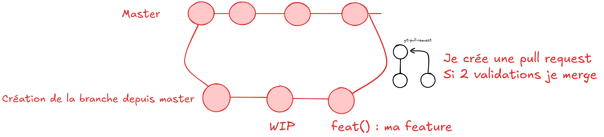

# Le guide du padawan du projet multidisciplinaire sur Git

## Introduction

Cette documentation à pour but de proposer une méthodologie d'usage de git. Comme nous travaillons à plusieurs, il est 
important de ce mettre d'accord sur un flow de travail autour de git.

## Comment je traite mon issue

La première étape, est de créer notre branche de travail, on ne travaille jamais directement sur Master ! 
On crée la branche en partant de l'issue, quand on clique sur le détail de l'issue (ticket). On clique sur
create branch. on définit la branche master comme une branche de départ pour créer notre branche à partir de celle-ci.

Ensuite on checkout depuis le terminal dessus, et ça y est on peut commencer notre tembouille.

## Les commits c'est essentiels

Un commit = une sous feature de la feature ou un commit d'avancé.

**Voici la nomanclature des branches :**
- feat() : {insère ici l'objet du commit} = une feature ou sous feature 
- bugfix() : {insère le bug résolu} = un bug à résourdre
- hotfix() : {problème à chaud résolu} = un bug qui a été merge sur master doît être traité
- chore() : {la corvée qu'on t'a filée} = ici on parle de traiter une issue de refacto ou juste de restructuration du projet
- WIP : c'est des commits de work in progress il faudra squash en 1 seul commit les WIP

## Graphiquement à quoi ça ressemble ?



## En commande git (je fais un bref tuto)

```bash
## Créer ma branche
git checkout -b "titre de l'issue"
## si la branche existe déjà parce que vous avez suivi l'interface graphique
git fetch origin;  git checkout la_branche
git add . ## j'ajoute tous les fichiers modifiés pour un commit
git commit -m "le message de commit voir nomanclature"
git push ## si la branche est pas publié suivre la commande du message d'erreur
```

```bash
## je veux récupérer les modifs du copain
git checkout la_branche_du_copain
git pull
git checkout ma_branche
git rebase la_branche_du_copain
## je résous ensuite commit par commit 
# je suis parfois obligé de push force après ça 
git push --force
 ```
Pour ouvrir la Pull Request vous vous rendez sur le repo on vous proposera de la créer !
